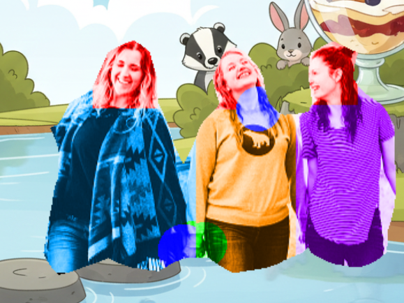
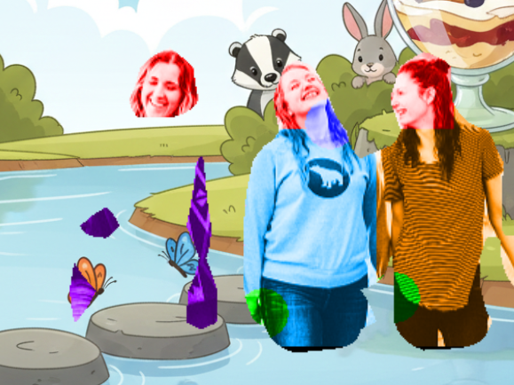
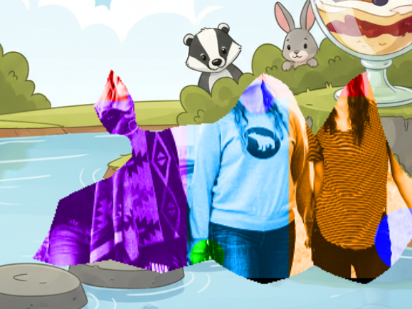
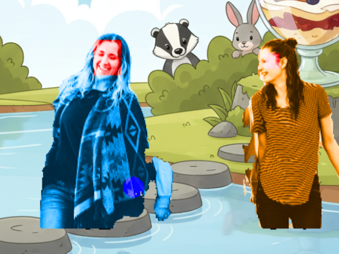
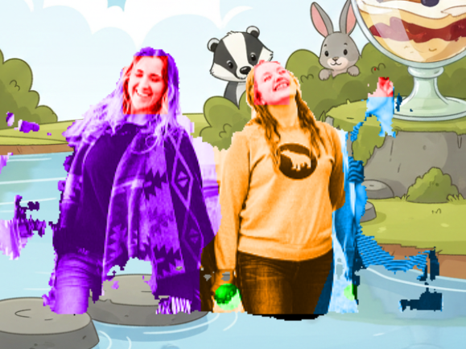

# ADR 0005: Vision models

- Status: Accepted
- Date: 2026-10-24

## Context

Players were tracked by BodyPix (tfjs), which labels every pixel with one of 24 body parts. It was slow, it
flickered, background clutter confused it, and it merged several players into one. A game needs two things for
each player: a silhouette, to cut them out of the camera view, and the positions of their hands, feet and head.
It must run locally in a browser on an M1 MacBook Pro (16 GB). Models were surveyed in October 2026, and the
leading options were measured.

[ADR 0004](0004-vision-optimisations.md) covers how any model is run (backend, worker, smoothing).

## Decision

1. **Body-part segmentation is dropped.** Only BodyPix (deprecated) and Sapiens (far too heavy for a browser)
   label body parts per pixel. Every model instead gives a silhouette per person and key points: the centres of
   the hands and feet, and the top, bottom, left and right of the head. The "hand" in a query is a disc around the
   hand's key point, scaled to the person's head, and clipped to their silhouette. This keeps "50% of the hand is
   inside the box".
2. **Models sit behind `FootstepsVisionModelImplementation`** (`src/vision/`), with our own `BodyPart`s. The
   base class answers which body parts are at a point, and how much of each is inside an area, for any model's
   frames. `VITE_VISION_MODEL` chooses:
   - `bodypix`, **the default**: BodyPix MobileNetV1 (0.75), stride 16, via the standalone
     `@tensorflow-models/body-pix`. Key points are the centroids of its part pixels.
   - `mediapipe`: MediaPipe Pose Landmarker (`@mediapipe/tasks-vision`), with 33 landmarks and a mask per person.
   - `movenet`: MoveNet MultiPose Lightning for the key points, with MediaPipe's selfie segmenter for the
     silhouette, divided between people by whose skeleton each pixel is nearest.
3. **BodyPix MobileNetV1 is the default** because it found everyone in every photo except the backlit one, and it
   gave the cleanest separate silhouettes, at 9–20 fps for one to three people.

## Measurements

`VISION_BENCH=1 scripts/run-browser-tests.sh vision-bench` shows each scene to a fake camera (640×480, 30 fps)
in headless Chromium on an M1 MacBook Pro. The scenes are an empty room, and seven CC0 photos of one to three
people from Wikimedia Commons (`tests/browser/fixtures/people/`, with credits). Each cell gives the people found
out of those expected, then the median inference time in ms. "s16" and "s32" are output strides; all BodyPix
columns use 2-byte weights.

| Scene            | BodyPix ResNet50 s32, WebGL | BodyPix ResNet50 s32, WebGPU | BodyPix ResNet50 s16, WebGPU | BodyPix MobileNetV1 s16, WebGPU | MediaPipe Pose lite | MediaPipe Pose full | MediaPipe Pose heavy | MoveNet + selfie, WebGL | MoveNet + selfie, WebGPU |
| ---------------- | --------------------------- | ---------------------------- | ---------------------------- | ------------------------------- | ------------------- | ------------------- | -------------------- | ----------------------- | ------------------------ |
| empty room       | 0/0 · 138                   | 0/0 · 67                     | 0/0 · 98                     | 0/0 · 23                        | 0/0 · 15            | 0/0 · 15            | 0/0 · 16             | 0/0 · 40                | 0/0 · 20                 |
| jumping, arms up | 1/1 · 144                   | 1/1 · 68                     | 1/1 · 100                    | 0/1 · 25                        | 0/1 · 15            | 0/1 · 14            | 0/1 · 15             | 0/1 · 39                | 0/1 · 20                 |
| jumping, side-on | 1/1 · 144                   | 1/1 · 76                     | 1/1 · 114                    | 1/1 · 40                        | 1/1 · 28            | 1/1 · 27            | 1/1 · 43             | 1/1 · 40                | 1/1 · 20                 |
| two facing       | 2/2 · 152                   | 2/2 · 87                     | 2/2 · 122                    | 2/2 · 49                        | 1/2 · 27            | 1/2 · 24            | 0/2 · 39             | 2/2 · 42                | 2/2 · 23                 |
| three friends    | 3/3 · 152                   | 3/3 · 120                    | 3/3 · 143                    | 3/3 · 86                        | 2/3 · 37            | 2/3 · 39            | 2/3 · 74             | 3/3 · 45                | 3/3 · 27                 |
| two from behind  | 2/2 · 153                   | 2/2 · 124                    | 2/2 · 158                    | 2/2 · 86                        | 2/2 · 38            | 1/2 · 25            | 2/2 · 73             | 2/2 · 42                | 2/2 · 25                 |
| busy street      | 2/2 · 146                   | 2/2 · 84                     | 2/2 · 117                    | 2/2 · 44                        | 1/2 · 27            | 1/2 · 26            | 1/2 · 44             | 2/2 · 40                | 2/2 · 20                 |
| backlit three    | 1/3 · 149                   | 1/3 · 124                    | 2/3 · 153                    | 1/3 · 57                        | 0/3 · 21            | 1/3 · 28            | 1/3 · 44             | 1/3 · 39                | 1/3 · 20                 |

The coloured debug view of "three friends" (each person tinted; head red, hands green and blue):

| BodyPix MobileNetV1 s16 (default)                                           | BodyPix ResNet50 s16                                                              | BodyPix ResNet50 s32                                                              |
| --------------------------------------------------------------------------- | --------------------------------------------------------------------------------- | --------------------------------------------------------------------------------- |
|  |  |  |
| **MediaPipe Pose full**                                                     | **MoveNet + selfie segmenter**                                                    |                                                                                   |
|              |      |                                                                                   |

- BodyPix MobileNetV1 separates all three people cleanly.
- ResNet50 at stride 16 loses most of the left-hand person; at stride 32 its masks are coarse blocks.
- MediaPipe Pose's masks are crisp, but it misses the middle person.
- MoveNet places all three, but the selfie segmenter, made for close-up selfies, barely masks the right-hand
  person, and lets stray background through.

## Options considered

| Model                                     | Runs on                               | People     | Silhouette         | Key points            | Licence      | Outcome                  |
| ----------------------------------------- | ------------------------------------- | ---------- | ------------------ | --------------------- | ------------ | ------------------------ |
| BodyPix MobileNetV1 / ResNet50            | tfjs, WebGL or WebGPU                 | up to 10   | yes, 24 body parts | from part centroids   | Apache-2.0   | default (MobileNetV1)    |
| MediaPipe Pose Landmarker lite/full/heavy | tasks-vision wasm, GPU delegate       | several    | yes                | 33, incl. heels, toes | Apache-2.0   | implemented              |
| MoveNet MultiPose Lightning               | tfjs graph model                      | up to 6    | no                 | 17                    | Apache-2.0   | implemented, with selfie |
| MediaPipe selfie segmenter                | tasks-vision wasm, GPU delegate       | all as one | yes                | none                  | Apache-2.0   | MoveNet's silhouette     |
| YOLO26 pose / segmentation                | `@ultralytics/yolo`, LiteRT.js WebGPU | many       | yes                | 17                    | AGPL-3.0     | not chosen               |
| RTMPose / RTMO (MMPose)                   | ONNX Runtime Web (eg. rtmlib-ts)      | many       | no                 | 17–133 (whole body)   | Apache-2.0   | not chosen               |
| Sapiens body-part segmentation            | PyTorch / ONNX                        | many       | yes, 28 parts      | 308                   | CC BY-NC 4.0 | not chosen               |
| SAM 2 / EfficientSAM                      | ONNX / WebGPU                         | prompted   | yes                | none                  | Apache-2.0   | not chosen               |

### BodyPix (kept, default)

- **For:** it is the only real-time model that segments each person in a browser out of the box. It found
  everyone in the photos except the backlit three. MobileNetV1 at stride 16 on WebGPU is fast enough, at 9–20 fps
  for one to three people.
- **Against:** deprecated by Google since 2023, and loaded from Google's storage. Its per-person split runs on the
  CPU, so time grows with the number of people. It lost the small greyscale jumper (as did MediaPipe and MoveNet;
  ResNet50 found them). It ignores `flipHorizontal` for masks, which is fine here because the canvas is mirrored
  with CSS.

### MediaPipe Pose Landmarker (implemented)

- **For:** the fastest (15–40 ms), crisp masks, maintained (1.x in 2026), and 33 landmarks including heels and toes
  for precise feet. The wasm runtime is bundled from the package, so it always matches the library.
- **Against:** it regularly missed people in groups (1 of 2 facing, 2 of 3 friends). Its detector favours one
  prominent person, so it suits single-player games. Its model files load from Google's storage.

### MoveNet MultiPose with the selfie segmenter (implemented)

- **For:** the fastest option that still counted people correctly (20–27 ms on WebGPU, 20–30 fps), at a steady cost
  as people are added. It is loaded as a plain tfjs graph model, with our own decoding, so it needs no new
  dependency.
- **Against:** no silhouette of its own. The selfie segmenter is made for close-up selfies: it masks people far from
  the centre poorly and lets background through. Hands and feet are estimated beyond the wrists and ankles. The
  official `@tensorflow-models/pose-detection` package was avoided, because it imports `@mediapipe/pose`, which
  can't be bundled.

### YOLO26 (not chosen)

Ultralytics' YOLO26 (September 2025) does pose and instance segmentation in one model, and has an official browser
package on LiteRT.js with WebGPU. It is a strong candidate for accuracy with many people and cluttered backgrounds.
But it is AGPL-3.0, which would oblige us to publish the game's source under the AGPL, or to buy an Ultralytics
licence. Revisit if the licence is acceptable, as the next model to add behind the interface.

### RTMPose / RTMO (not chosen)

These are accurate multi-person whole-body pose models (Apache-2.0) that run in the browser through ONNX Runtime Web
(rtmlib-ts reports 40–200 ms). They have no silhouette, so they would need a segmenter as MoveNet does, and they
add a second ML runtime. Revisit if hand or finger precision matters.

### Sapiens, SAM 2 (not chosen)

Meta's Sapiens does excellent 28-part body segmentation, but the useful sizes are 0.3–2 billion parameters at
1024 px; it is non-commercial and nowhere near real time in a browser. SAM-family models segment anything, but
they need prompts (points or boxes) every frame and are too slow for 30 fps.

### Hardware and WebNN

WebNN, which could reach the Apple Neural Engine, is only in a Chrome origin trial (146–147). ONNX Runtime's WebNN
path is Windows-only, and Safari has given no signal. Revisit when it ships. See
[ADR 0004](0004-vision-optimisations.md) for USB accelerators and remote inference.

## Consequences

- Games and the interaction monitor see only our `BodyPart`s (`body`, `head`, hands and feet), and never a
  model's own labels. Adding a model means one class in `src/vision/models/` and a case in `createModel`.
- Switching model needs no code change: `.env`, or `?visionModel=mediapipe` for one visit.
- The bench's photos and per-scene report make a model change measurable, both in speed and in people found.
- BodyPix and MoveNet load models from Google's storage, and MediaPipe's model files load from Google's storage
  too. A venue without internet would need them self-hosted: see `docs/outstanding-issues.md`.
- The head box for MediaPipe and MoveNet comes from the ears and eyes, with typical proportions. It is not
  measured from the mask, so it is approximate.

## Sources

- BodyPix and body-segmentation (deprecated): <https://github.com/tensorflow/tfjs-models/tree/master/body-segmentation>
- MediaPipe Pose Landmarker: <https://ai.google.dev/edge/mediapipe/solutions/vision/pose_landmarker>
- MoveNet MultiPose: <https://www.kaggle.com/models/google/movenet>
- YOLO26: <https://docs.ultralytics.com/models/yolo26/>
- RTMPose and rtmlib-ts: <https://dev.to/gohdev_1/rtmlib-ts-real-time-pose-estimation-object-detection-in-browser-with-typescript-yolo12-48ep>
- Sapiens: <https://github.com/facebookresearch/sapiens>
- WebNN origin trial: <https://groups.google.com/a/chromium.org/g/blink-dev/c/5CWKSChYo98>
