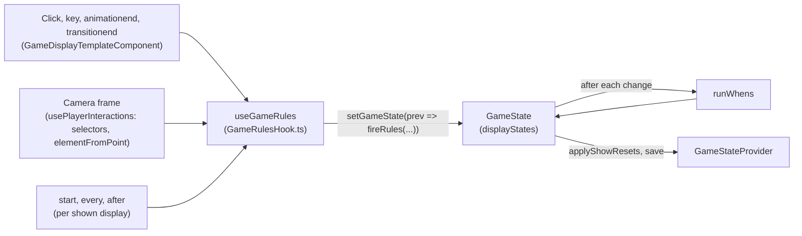

# Developer overview

Footsteps is a Vite + React + TypeScript app. It uses React Router's framework mode to prerender every page to static HTML for GitHub Pages ([ADR 0001](ADRs/0001-replace-vite-react-ssg-with-react-router-framework-mode.md)).

## Prerequisites

- `bash`, `git`, and Node 26: `.nvmrc` names the version CI and deployment use (`nvm use` picks it up), and `engines.node` in `package.json` the minimum (LTS from 2026-10-28)
- Tool versions come from `package-lock.json` alone. The scripts run tools with `npx --no-install`, so a missing tool fails rather than downloading the latest. Run `npm ci` first. `dev-qual/scripts/check.sh` runs `markdownlint` from your PATH, so locally either put `node_modules/.bin` on your PATH or install the same version globally (`npm i -g markdownlint-cli@0.49.1`). CI uses the project's copy.
- [Code formatting configuration](code-formatting.md)
- The `dev-qual` submodule: `git submodule update --init`

## Layout

| Path                         | What it is                                                                    |
| ---------------------------- | ----------------------------------------------------------------------------- |
| `react-router.config.ts`     | Static build settings: no server, the routes to prerender, the base path      |
| `src/root.tsx`               | The HTML document every page renders into (head tags, security policy)        |
| `src/routes.ts`              | Route config: `/`, `/game/:id`, `/game/:id/play`, `/game/:id/json`            |
| `src/pages/`, `src/Home.tsx` | Route modules (one page each)                                                 |
| `src/components/`            | Game engine UI: layers, displays, camera, and the game logic in `core/logic/` |
| `src/config/`                | App config: settings from the `.env*` files, overridable by URL query         |
| `src/vision/`                | Vision models behind one interface, body-part queries, tracking, the worker   |
| `src/providers/`             | React contexts: repository, game data, game state, music, app config          |
| `tests/`                     | Vitest unit and component tests                                               |

## Invocations

| Command                        | Does                                                                                                                    |
| ------------------------------ | ----------------------------------------------------------------------------------------------------------------------- |
| `npm run dev`                  | Dev server on <http://localhost:5173>                                                                                   |
| `npm run build`                | Typecheck, then prerender every page to a static site in `dist/client/`                                                 |
| `npm run build:gh-pages`       | As `build`, under the GitHub Pages base path: `$BASE_URL`, or `/footsteps/` if unset (see: [deployment](deployment.md)) |
| `npm run preview`              | Serve `dist/client/` locally                                                                                            |
| `npm test`                     | Validate the game data, then run the tests once                                                                         |
| `scripts/run-browser-tests.sh` | Playwright browser tests against a fake webcam, locally only (see [browser tests](#browser-tests))                      |
| `npm run test:run`             | The same: validate `public/game-repository.json`, then run the tests                                                    |
| `npm run validate`             | Validate `public/game-repository.json`: schema, resource files and URLs, resource names, and stage links                |
| `npm run lint:check`           | ESLint, failing on any warning                                                                                          |
| `npm run typecheck`            | TypeScript, no output                                                                                                   |
| `npm run docs:api`             | Regenerate the API reference in `docs/tsdoc/` as HTML from the TSDoc comments, failing on any undocumented export       |
| `npm run docs:dev`             | Documentation site at <http://localhost:5173/docs/>, with live reload (VitePress)                                       |
| `npm run docs:build`           | Build the documentation site into `docs-static/`                                                                        |
| `npm run format`               | Prettier, rewriting files (`format:check` only reports)                                                                 |

`dev`, `build`, `lint`, `preview`, and `test` first run `pre-build.sh`, which regenerates `src/assets/license-report.json` and the JSON schemas. `test` also validates the game data.

## Documentation

- [Documentation](https://instantiator.dev/footsteps/docs/)
- [API reference](https://instantiator.dev/footsteps/docs/tsdoc/)

`docs/` is published as a static site at `/docs/` on GitHub Pages. VitePress renders the Markdown pages with its default theme (sidebar, page outline, and local search), and TypeDoc renders the TSDoc comments in `src/` to HTML in `docs/tsdoc/`. `build-docs-site.sh` builds both and assembles them into `dist/client/docs/`; `npm run build:gh-pages` runs it after the app build, so the docs deploy with the app.

Use `npm run docs:dev` for the Markdown pages locally, and `npm run docs:api` to regenerate the API reference after changing `src/`.

## Quality gate

`dev-qual/scripts/check.sh` runs formatting, lint, typecheck, build, tests, shell/workflow/markdown linters, and an [aislop](https://www.npmjs.com/package/aislop) scan. `--fast` (format, lint, typecheck only) runs as the git pre-commit hook; the full gate runs as the pre-push hook, and in CI on every pull request and push to `main` (`.github/workflows/check.yaml`), which shows test results as annotations and a job summary, with the JUnit file as a downloadable artefact. Before committing, the hook also runs `scripts/pre-commit-fixups.sh`, which runs `scripts/pre-commit-checks.sh` (the data validator's unit tests, and an advisory data check), regenerates the HTML API reference in `docs/tsdoc/` whenever `src/`, `typedoc.json` or `package.json` is staged, and the JSON schemas whenever `src/entities/` is staged, and adds them to the commit. An export without a TSDoc comment fails the commit. aislop compares against `.aislop/ci-baseline.json` (accepted findings) and `ci.failBelow` in `.aislop/config.yml`, and skips generated output listed in `.aislopignore`.

## Browser tests

`tests/browser/` runs the real camera pipeline in Chromium against a fake webcam, covering the
landing page and route split, the silhouette loop, debug changes, preview visibility, camera-off
displays, image switching, and the game view easing into the camera's shape before its display fades
in. It is local only: it downloads the vision model, and needs the GPU to track fast enough, so it is not
part of the pre-push gate or CI. An opt-in benchmark compares models on photos of people; see
[camera mode](camera-mode.md#testing).

```bash
npx playwright install chromium  # once
scripts/run-browser-tests.sh
```

The config uses port `5180`, reuses a dev server already running there, and enables Metal on macOS
so headless segmentation is fast enough to test. See [manual testing](testing/manual-testing.md) for
the checks it does not replace.

## Sample games

Every game in the local repository, `public/game-repository.json`, is prerendered at its own URL:

| Game           | Landing page                              | Play page                                      | Game data URL                                  |
| -------------- | ----------------------------------------- | ---------------------------------------------- | ---------------------------------------------- |
| `magic-trifle` | <http://localhost:5173/game/magic-trifle> | <http://localhost:5173/game/magic-trifle/play> | <http://localhost:5173/game/magic-trifle/json> |

`public/test-repository.json` holds `test-game`, which isn't in the local repository, so
`/game/test-game` shows "not found".

## Schemas

`pre-build.sh` generates JSON schemas from the TypeScript types:

| Type             | Schema                                       |
| ---------------- | -------------------------------------------- |
| `GameRepository` | `public/schemas/game-repository-schema.json` |
| `GameData`       | `public/schemas/game-data-schema.json`       |

### Clickable elements in templates

Any display's template makes elements interactive through the display's [rules](game-data.md#rules-and-state):
a rule names the elements with a CSS selector, and the interactions it accepts (click, hand, foot, head, body,
any, jump; see [camera mode](camera-mode.md#how-interactions-work) for what the camera detects). For keyboard
players, also mark each element a player can currently use with `role="button"`, `tabindex="0"`, and a label
(`alt` on an image, or `aria-label`): the display then treats Enter or Space on it as a click. On the title
screen, Enter or Space anywhere moves on, as a click does. See `public/games/magic-trifle/overview/foreground.hbs`.

### How rules run

`compileGameRules` (`src/components/core/logic/GameRuleUtils.ts`) compiles every rule expression when the game
loads ([filtrex](filtrex.md)), and `GameDataProvider` reports `rules-error` if one doesn't parse. While playing:



- The engine (`fireRules`, `runWhens`, `applyShowResets`) is pure: each change is a function of the latest
  `GameState`, so no rule receives `setGameState`, and events between renders compose.
- Display state lives in `GameState.displayStates`, keyed by display scope (`overview:<purpose>`,
  `stage:<id>:shared`, `challenge:<stage>:<challenge>:<purpose>`), and is saved with the progress.
- `GameDisplayTemplateComponent` patches its HTML in place with idiomorph, after DOMPurify, so elements keep
  their transitions. Its container carries `data-display-scope`, which the camera uses to find a display's elements.
- See [ADR 0006](ADRs/0006-display-rules-and-state.md) for why it is built this way.

### Validate data

Both scripts check a data file against its JSON schema, then check that everything it names can load:

- every `resources` target and display template source: `local` paths under the site root (`public/`), `relative` paths beside the repository, and `url`s with an HTTP request (10 second timeout);
- every resource name used by `sounds`, `stylesheets`, a dialog's `imageResource` and page `media` is defined in `resources`.

Problems are printed with the field's JSON path and the resolved file or URL, and the script exits non-zero. Add `--skip-urls` to check local files only, for offline use.

```bash
./validate-repository.sh public/game-repository.json
```

```bash
./validate-game.sh path/to/some-game.json
```

A standalone game has no repository file, so its `relative` targets resolve against the site root too; pass `--repository-root <dir>` to resolve them elsewhere. `npm run validate` checks the site's own repository, and `npm test` runs it first, so the pre-push hook and CI block on invalid data. At pre-commit, `scripts/pre-commit-checks.sh` runs the validator's unit tests (blocking) and the data check with `--skip-urls` (advisory).
