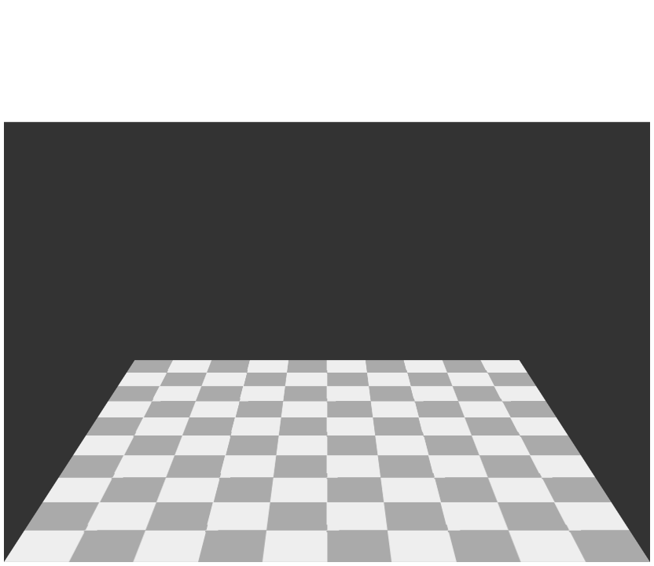
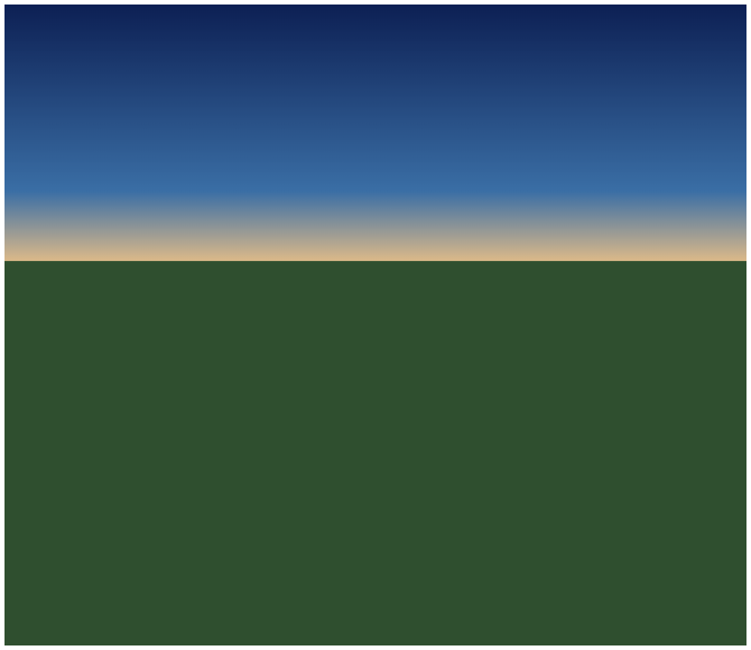
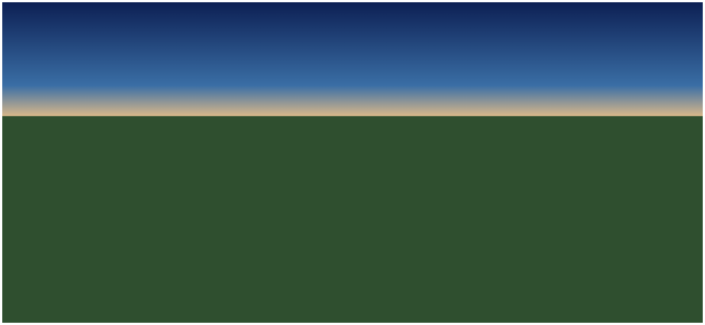

# Positions, sizes and units in 2.5D scenes

A short reference for where things go in a 2.5D scene, and the names that put them there.
[Game data](game-data.md#floor-surfaces) has the details of each. The [tutorials](tutorials/index.md) show how to put
them together, and [sample elements](tutorials/sample-elements.md) has copy-and-paste HTML for each.

## Positions, sizes and units

- **The screen** is the whole game area. **The scene box** is a rectangle at the floor's shape, as large as fits,
  standing on the screen's bottom edge and centred. In camera mode, it is the part of the camera image that holds the
  floor. A screen wider than the scene has room at the sides; a taller one has sky above.
- **Ordinary HTML** in a template lays out in the scene box. `%`, `cqw` and `cqh` are fractions of it, so `50cqw` is
  half the scene box's width on any screen. A scene's `backgroundStyle` fills the scene box too, so a background
  picture stays lined up with what is placed on it.
- **Floor coordinates** run 0–100: x from the floor's left edge to its right, y from its back to its front. They can go
  outside 0–100, behind the back edge or off to the sides.
- **Heights** (`data-floor-height`, `data-floor-depth`) and **distances** (`data-wall-distance`) are in floor units:
  100 is the floor's width.
- **Box scale.** Where the engine sizes a surface's box, it sets `--floor-unit` on it to the pixels a floor unit takes
  in the box. Size textures with it, so they keep one size across the floor and up the walls:
  `background-size: calc(var(--floor-unit) * 20)` repeats every 20 floor units. Most boxes are drawn at the floor's
  front edge's scale, where `--floor-unit` is `1cqw`; very large ones, like the floor background, are drawn smaller.
  A box whose shape sets its size, like a floor area or a wall with no height set, is yours, and has no
  `--floor-unit`: size its texture in `%` of the box instead.
- **Floor items** (`data-floor-y` and so on) stand at a floor spot and scale with distance. **Surfaces** (the classes
  below) are drawn in the floor's perspective, and can reach past the scene box to the screen's edges. Everything else
  is plain 2D in the scene box.

## Scene elements

| Class or attribute                                       | Applies to                          | Meaning                                                                                                                                                                                         |
| -------------------------------------------------------- | ----------------------------------- | ----------------------------------------------------------------------------------------------------------------------------------------------------------------------------------------------- |
| `data-floor-y`, `data-floor-x`                           | any element                         | Stands the element on that floor spot. x defaults to where the layout put it across the scene box.                                                                                              |
| `data-floor-height`                                      | floor item                          | How high its anchor sits above the floor, in floor units; it shrinks with distance.                                                                                                             |
| `data-floor-anchor`                                      | floor item                          | Which point of the element stands on the spot (default `center bottom`).                                                                                                                        |
| `data-floor-thickness`                                   | floor item                          | The depth of floor it covers, for feet interactions.                                                                                                                                            |
| `data-floor-area="left back right front"`                | any element                         | Lays the element flat on that floor rectangle. Feet count only where it's drawn. `"0 0 100 100"` is the floor.                                                                                  |
| `screen-background`                                      | class                               | Fills the whole screen, square on, behind everything. For a scene with no floor or horizon.                                                                                                     |
| `screen-foreground`                                      | class                               | Fills the whole screen, square on, in front of everything in its layer; it lets the pointer through. For a full-screen tint or overlay, in a foreground template to be in front of the players. |
| `horizon-background`                                     | class                               | The furthest backdrop: upright, filling the screen above it. The floor background stops at it.                                                                                                  |
| `floor-background`                                       | class                               | The endless floor plane, across the screen, from the bottom back to the horizon.                                                                                                                |
| `data-floor-depth`                                       | `floor-background`                  | How far below the floor the plane lies (default 0).                                                                                                                                             |
| `rear-background`, `left-background`, `right-background` | class                               | Upright backdrops further out, behind the walls (default distance 50).                                                                                                                          |
| `rear-wall`, `left-wall`, `right-wall`, `front-wall`     | class                               | Upright surfaces on the floor's edges.                                                                                                                                                          |
| `data-wall-distance`                                     | walls, backgrounds, horizon         | How far out from the floor's edge it stands, in floor units (horizon default 1000).                                                                                                             |
| `data-floor-height`                                      | walls, backgrounds                  | Fixes its height. Otherwise its box's shape sets it: a box a tenth as high as it is wide makes a wall 10 units high.                                                                            |
| `data-fill-height`                                       | walls, backgrounds                  | Stretches it up to the screen's top.                                                                                                                                                            |
| `data-fill-width`                                        | rear or front wall, rear background | Stretches it sideways to the screen's edges.                                                                                                                                                    |
| `data-fill-edge="near\|far"`                             | side walls and backgrounds          | With `data-fill-height`, which end reaches the top (default `far`, which never leaves a gap).                                                                                                   |
| `noClicks`                                               | class, any wrapper                  | Lets the pointer through to what's beneath; its children still take it.                                                                                                                         |
| `mouse-feet-avatar`                                      | class, set by the engine            | The pointer's feet in [mouse-feet](camera-mode.md#mouse-feet), sized in floor units, with `data-airborne` mid-jump; restyle it in a game's stylesheet.                                          |

Surfaces paint back to front: the screen background, the horizon, the floor background, the backgrounds, floor areas,
then walls.

## Examples

Each example is a whole template: paste it into the scene renderer (`/scene-renderer`) to try it.

### A fence of a given height

`data-floor-height="8"` makes the fence 8 floor units high, so 8% of the floor's width, wherever the floor is. The engine
sizes its box, so the slats and rails are sized with `--floor-unit`: a slat 1.5 units wide every 5 units, and rails 0.8
units thick.

```html [docs/tutorials/samples/fence.html]
<div
  class="rear-wall"
  data-floor-height="8"
  style="
    background:
      linear-gradient(#a76 0 0) 0 25% / 100% calc(var(--floor-unit) * 0.8) no-repeat,
      linear-gradient(#a76 0 0) 0 70% / 100% calc(var(--floor-unit) * 0.8) no-repeat,
      repeating-linear-gradient(90deg, #a76 0 calc(var(--floor-unit) * 1.5), transparent 0 calc(var(--floor-unit) * 5));
  "
></div>
```


### Person scale

Floor units are relative to the floor, so a fixed size like `data-floor-height="7"` is shin height on a large floor and
waist height on a small one. To size things to people, use the `scale` template values. They are in floor units, worked
out from the floor size measured at [calibration](camera-mode.md#calibrating-the-floor), or from the default floor
(2.6 m × 2 m) when none was:

| Value                 | What it is                                       | On the default floor |
| --------------------- | ------------------------------------------------ | -------------------- |
| `{{scale.metre}}`     | a metre across the floor, or up from it          | 38.5                 |
| `{{scale.metreDeep}}` | a metre from the floor's back to its front, in y | 50                   |
| `{{scale.person}}`    | an adult's height (1.7 m)                        | 65.4                 |
| `{{scale.waist}}`     | waist height (0.9 m)                             | 34.6                 |
| `{{scale.chest}}`     | chest height (1.3 m)                             | 50                   |
| `{{scale.door}}`      | a door's height (2 m)                            | 76.9                 |
| `{{scale.doorWidth}}` | a door's width, across the floor (0.9 m)         | 34.6                 |

For example, `data-floor-height="{{scale.chest}}"` floats an item at chest height in any room. Handlebars can't do
arithmetic, so use the nearest named size.

**Sizing items in metres.** A floor item is sized as it would appear at the front edge, where a floor unit is `1cqw`.
So set a metre once on the template's outer element, and size items with CSS `calc`, which can do arithmetic:

```html
<div class="demo-screen" style="--metre: calc(1cqw * {{scale.metre}})">…</div>
```

```css
.door {
  width: calc(var(--metre) * 0.9);
  height: calc(var(--metre) * 2);
}
```

**A guide to person-sized scenes.** Players stand in the room, so what they reach for should be where they would reach
for it in real life:

- **Things to touch by hand** float between waist and chest: anchor their bottom at `{{scale.waist}}` and make them
  about 0.4 m tall. Give each a floor area beneath it too, so standing near counts, as hands aren't always found from
  behind.
- **Doors** are about 2 m × 0.9 m, and open on any of: standing in front of them or behind them (floor areas, held for
  0.5 s), a hand or foot on them while standing near, or a click. Give the door `data-floor-thickness`, so a hand or
  foot only counts from someone standing near it in depth, then one rule covers both:

  ```json
  [
    { "on": { "interact": "foot-enter", "target": ".door-area", "threshold": 0.05, "holdMs": 500 }, "do": [] },
    { "on": { "interact": ["hand-enter", "foot-enter"], "target": "#door", "threshold": 0.05 }, "do": [] },
    { "on": { "interact": "click", "target": "#door" }, "do": [] }
  ]
  ```

  with the same `if` and `do` in each, and `.door-area` the floor areas in front of and behind it.

- **Signs and markers** stand about waist high, so they read as objects in the room rather than marks on the floor.
- **Hazards and paths** are sized to a stride: a pit about 0.4 m deep and a metre or more across can't be stepped
  over by accident, and a path or bridge about 0.5 m wide fits one person's feet. On a small floor, fewer, larger
  hazards keep their peril better than many small ones.

### A tiled floor

A floor area covering the whole floor (`0 0 100 100`) is 100 floor units square, so its box is square
(`aspect-ratio: 1`). Its box is the author's, with no `--floor-unit`, so the tiles are sized in `%`: a pattern repeat of
20% holds two tiles, so each tile is 10 floor units, and there are ten across. The floor background beyond it is plain.

```html [docs/tutorials/samples/tiled-floor.html]
<div class="floor-background" style="background: #333"></div>

<div
  data-floor-area="0 0 100 100"
  style="aspect-ratio: 1; background: repeating-conic-gradient(#eee 0 25%, #aaa 0 50%) 0 0 / 20% 20%"
></div>
```



### A sky that fills a wide screen

The scene box keeps the floor's shape, so a screen wider than the scene has room at the sides. The horizon background
fills the screen above the horizon whatever its shape, and the floor background reaches to the screen's edges, so
nothing is left blank.

```html [docs/tutorials/samples/wide-sky.html]
<div
  class="horizon-background"
  data-wall-distance="200"
  style="background: linear-gradient(#0b1d51, #3a6ea5 70%, #f9c784)"
></div>
<div class="floor-background" style="background: #2f4f2f"></div>
```



On a screen more than twice as wide as it is high:


