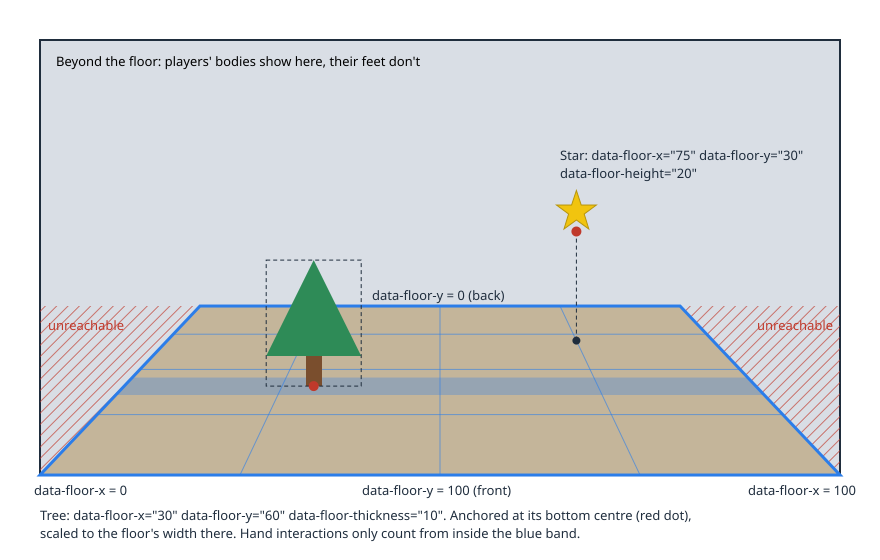

# A 2.5D scene

In a 2.5D scene, the game is fitted to the floor of the room. Things stand on the floor and shrink as they go further
back, players walk in front of them and behind them, and walls, hills and sky fill the screen around the floor. This
tutorial builds a room to walk around, then a bridge over a floor of lava. It follows the **Demo scenes**
game's "Walk around" and "Bridge across lava" stages; every snippet is quoted from `public/game-repository.json` and
`public/games/rules-demo/`.

Start from [your first game](your-first-game.md) and [a scene without a camera](scene-without-camera.md).
[Positions, sizes and units](../positions-sizes-units.md) is a one-page summary of the measurements, and
[sample elements](sample-elements.md) has a picture of each part used here.

## The floor

Before playing a 2.5D game with the camera, the player marks the floor: the part of the room they can walk around on,
as the camera sees it. They do it once per camera, on the landing page, and the calibration page explains how
([calibrating the floor](../camera-mode.md#calibrating-the-floor)). Without a camera, the game uses a default floor.

You never place anything in screen pixels. Instead you use **floor coordinates**, which work in every room:



- x runs from 0 at the floor's left edge to 100 at its right; y from 0 at the back to 100 at the front.
- Heights and distances are in the same units: 100 is the floor's width.
- The scene's HTML lays out in the **scene box**, a rectangle at the floor's shape, standing on the screen's bottom
  edge. `%`, `cqw` and `cqh` are fractions of it ([fitting the view](../camera-mode.md#fitting-the-view-to-the-floor)).

## Step 1: a 2.5D scene, with feet

The game's scenes are 2.5D, and the walk-around challenge plays with the camera, or, without one, with the mouse as
the player's feet:

```json [public/game-repository.json]
"modules": {
  "scene": "2.5D",
  "avatar": { "mode": "mouse" },
…
"purpose": "challenge-in-progress",
"avatar": { "mode": "camera", "fallback": "mouse-feet" },
```

With `mouse-feet`, the pointer is player 1's feet: moving it over the floor walks, and it fires the same `foot-enter`
rules a camera player's feet would ([mouse-feet](../camera-mode.md#mouse-feet)). The feet are drawn as a footprint on
the floor; `"feet": { "color": "orange" }` beside `mode` changes its colour. It's the quickest way to try a 2.5D
scene: open it with `?noCamera=true` to play by mouse even with a camera.

The game's `modules` also set how [spectators](../game-data.md#spectators), people the camera sees standing off the
floor, are drawn: faded and grey, and never playing.

## Step 2: sky, ground and hills

The room's template starts with the surfaces furthest away. Each is an element with a surface class, drawn by the
engine in the floor's perspective, out to the screen's edges ([floor surfaces](../game-data.md#floor-surfaces)).

```html [public/games/rules-demo/depth.html]
<div class="horizon-background demo-horizon"></div>
<div class="floor-background demo-ground"></div>
<div class="rear-background demo-hills" data-fill-width></div>
```

- `horizon-background` is the sky: it stands at the horizon and fills the screen above it.
- `floor-background` is the ground, from the bottom of the screen back to the horizon.
- `rear-background` stands behind the floor, 50 floor units back. `data-fill-width` stretches it to the screen's
  sides. With no height set, its box's shape sets its height: `aspect-ratio: 4` makes it a quarter as high as it is
  wide.

```css [public/games/rules-demo/rules-demo.css]
.demo-horizon {
  background: linear-gradient(#457b9d, #a8dadc 90%, #f1faee);
}
.demo-ground {
  background: #52796f;
}
/* … */
.demo-hills {
  aspect-ratio: 4;
  background:
    radial-gradient(ellipse 30% 35% at 25% 100%, #2d6a4f 98%, transparent),
    radial-gradient(ellipse 40% 25% at 70% 100%, #40916c 98%, transparent);
  background-size: calc(var(--floor-unit, 1cqw) * 200) 100%;
}
```

`--floor-unit` is the size of a floor unit in the box, where the engine sizes it, so the hills repeat every 200 floor
units ([box scale](../positions-sizes-units.md#positions-sizes-and-units)).

**Look for:** open the walk-around with `?noCamera=true&debug=true`. Sky, grass and hills fill the screen. Debug
outlines the floor in blue and shades what's off it.

## Step 3: tiles on the floor

A floor area lies flat on a rectangle of the floor: `data-floor-area="left back right front"`. The room has sixteen
tiles, each 25 units square, and one of them is a spring:

```html [public/games/rules-demo/depth.html]
<div class="demo-tile" data-floor-area="0 0 25 25"></div>
<div class="demo-tile demo-tile-dark" data-floor-area="25 0 50 25"></div>
…
<div class="demo-tile" data-floor-area="0 50 25 75"></div>
<div id="depth-spring" class="demo-tile demo-spring" data-floor-area="25 50 50 75"></div>
```

The tiles are see-through, so a camera player's room shows through them:

```css [public/games/rules-demo/rules-demo.css]
.demo-tile {
  background: rgba(241, 250, 238, 0.45);
}
.demo-tile-dark {
  background: rgba(29, 53, 87, 0.45);
}
/* A spring in the floor: coils seen from above */
.demo-spring {
  background: repeating-radial-gradient(circle, #adb5bd 0 6%, #495057 6% 10%);
}
```

The spring is a target for a rule. Feet only count on a floor area where it's drawn
([standing on a floor area](../game-data.md#floor-surfaces)):

```json [public/game-repository.json]
{
  "on": { "interact": ["foot-enter"], "target": "#depth-spring" },
  "if": "not state.sprung",
  "do": [
    { "set": { "sprung": "true" } },
    {
      "series": [
        { "effect": "player-spin-away", "durationMs": 1000 },
        { "resetChallenge": true, "delayMs": 500 }
      ]
    }
  ]
},
```

`player-spin-away` spins a camera player off the screen ([spin away](../special-effects.md#spin-away)). The
[series](../game-data.md#series-and-parallel-groups) resets the challenge once the spin has ended, and a short pause
after. The mouse has no body to spin, so with the mouse the spin ends at once, and the challenge resets after the
pause.

**Look for:** a chequered floor. Move the pointer onto the spring, and the challenge starts again.

## Step 4: walls

Walls stand on the floor's edges. Like the hills, these take their height from their shape: a box 12% as high as it
is wide makes a wall 12 floor units high, knee height on a floor a few metres wide.

```html [public/games/rules-demo/depth.html]
<div class="rear-wall demo-wall"></div>
<div class="left-wall demo-wall"></div>
<div class="right-wall demo-wall"></div>
```

```css [public/games/rules-demo/rules-demo.css]
.demo-wall {
  aspect-ratio: 100 / 12;
  background: repeating-linear-gradient(90deg, #bc6c25 0 9%, #8f4d1c 9% 10%);
}
```

Surfaces paint back to front, whatever order they're written in: sky, ground, backgrounds, floor areas, then walls.
In a challenge's foreground, the rear and side walls stay behind every player. [Sample elements](sample-elements.md)
shows walls at a set height, and walls that fill the screen.

## Step 5: posts on the floor

A **floor item** stands on a floor spot, scaled for its distance ([floor-placed items](../game-data.md#floor-placed-items)).
Size it as it would look at the front of the floor, and give it `data-floor-x` and `data-floor-y`:

<!-- prettier-ignore -->
```html [public/games/rules-demo/depth.html]
<div id="depth-far" class="demo-depth-item" data-floor-x="20" data-floor-y="30">Far</div>
<div id="depth-near" class="demo-depth-item{{#if state.lit}} demo-depth-lit{{/if}}" data-floor-x="75" data-floor-y="80" data-floor-thickness="20">Near</div>
```

```css [public/games/rules-demo/rules-demo.css]
/* Posts for a player to walk behind and in front of, sized as at the front of the floor, where the engine stands them */
.demo-depth-item {
  position: absolute;
  left: 0;
  top: 0;
```

- The item's bottom centre stands on the spot. `data-floor-anchor` picks another point, and `data-floor-height` lifts
  it off the floor, as the [floor items sample](sample-elements.md#floor-items) does with a lantern.
- **Depth sorting.** Floor items in a challenge's foreground sort among the players by their floor y: a player
  further back than a post walks behind it, and one further forward walks in front
  ([sorting players](../camera-mode.md#sorting-players-among-floor-items)). Don't wrap floor items in an element with
  a `transform`, `opacity` or `isolation`, which would stop them sorting.
- **Thickness.** `data-floor-thickness="20"` is a band of floor 20 units deep, centred on the post. A camera player's
  interactions with the post only count while they stand in that band, beside it, rather than anywhere their
  silhouette overlaps it on screen. The mouse points at things rather than standing by them, so for the mouse it
  counts from anywhere.

The near post lights while the player stands by it:

```json [public/game-repository.json]
{
  "on": { "interact": ["foot-enter"], "target": "#depth-near" },
  "do": [{ "set": { "lit": "true" } }]
},
{
  "on": { "interact": ["foot-exit"], "target": "#depth-near" },
  "do": [{ "set": { "lit": "false" } }]
}
```

**Look for:** two posts, the far one smaller. Move the pointer to the foot of the near post, and it turns yellow; move
away, and it goes dark.

## Step 6: text and buttons over the scene

Anything that isn't floor-placed or a surface is plain HTML in the scene box, in front of the players, like a HUD.
The hint and the player's position are text over the scene; `noClicks` lets the pointer through them, so they don't
cover the floor for the mouse.

<!-- prettier-ignore -->
```html [public/games/rules-demo/depth.html]
<p class="noClicks demo-depth-hint">Walk around the posts. Stand beside the near one to light it. Mind the spring!</p>
…
<button id="depth-done" type="button" class="demo-depth-done">Done</button>
```

The "Done" button completes the challenge on a click. Scrolls and dialogs sit in front of the players too: the stage
opens with a scroll that introduces the room, as a challenge of its own before the walk-around.

```json [public/game-repository.json]
"id": "walk-around-intro",
"solution": { "answers": ["walk"] },
```

[Using players' floor positions](floor-positions.md) adds the ring that follows the player, and the position text.

## Step 7: start in the right place

Like the other stages, this one shares the demo's **grid reset**, a reset scene that waits for the player to stand on
Start before the room appears ([reset scenes](../game-data.md#reset-scenes)). Its template is a dark grid, with the
front-left cell lit up:

<!-- prettier-ignore -->
```html [public/games/rules-demo/reset.html]
<div id="reset-start" class="grid-start" data-floor-area="0 80 20 100">Start</div>
<p id="reset-message" class="grid-message">{{#if state.ready}}Get ready!{{else}}Stand on Start, or put your mouse on it{{/if}}</p>
```

The game defines it once, by name, and each stage asks for it:

```json [public/game-repository.json]
"resetScenes": {
  "start": {
    "showOn": "every-show",
    "scene": "2.5D",
    "avatar": { "mode": "camera", "fallback": "mouse-feet" },
```

**Look for:** "Stand on Start, or put your mouse on it". Put the pointer on the yellow cell: a chime and sparkles, a
countdown from 3, and then the posts appear.

## Bridge across lava

The last stage puts these pieces to work. The whole floor background is lava, except a zig-zag bridge, about a
person's width, from the Start cell to a stone landing where a life-size door stands. The bridge is five SVG paths in one floor area covering the whole floor, so the SVG's coordinates are
floor percentages. The template is the challenge's **background**, so everything in it, bridge included, stays behind
the player.

<!-- prettier-ignore -->
```html [public/games/rules-demo/bridge.html]
<div class="noClicks demo-screen" style="--metre: calc(1cqw * {{scale.metre}})">
  <div class="screen-background cavern-dark"></div>
  <div class="rear-background cavern-rock" data-fill-width></div>
  <div id="lava" class="floor-background lava"></div>
  <!-- A zig-zag bridge about 0.5 m wide (on the default floor) in five sections, drawn in floor percentages; only its
       painted shapes catch feet -->
  <div class="bridge-floor" data-floor-area="0 0 100 100">
    <svg viewBox="0 0 100 100" preserveAspectRatio="none">
…
```

The lava's glow is sized in floor units, so it keeps one size from the front of the floor to the horizon, and the cavern
wall behind it is layered gradients, with no pictures:

```css [public/games/rules-demo/rules-demo.css]
.lava {
  background: radial-gradient(circle, #ffd166, #ef476f 60%, #c1121f) 0 0 / calc(var(--floor-unit) * 20) repeat;
}
```

A foot on the lava warns the player, with `player-static`, a red glow in the template, and a `highlight` on the
player. Stepping back on the bridge ends it, but 2 s on the lava (`holdMs`) makes the player fall, and starts again:

```json [public/game-repository.json]
{
  "on": { "interact": ["foot-enter"], "target": "#lava", "threshold": 0.05 },
  "if": "not state.warning and not state.falling",
  "do": [
    { "set": { "warning": "true" } },
    { "effect": "player-static", "pixelSize": 2, "proportion": 1, "easeMs": 800 },
…
},
{
  "on": { "interact": ["foot-enter"], "target": "#lava", "threshold": 0.05, "holdMs": 2000 },
  "if": "not state.falling",
```

Stepping onto the next section sets where the player is, and the section behind them quakes, falls with `item-fall`,
and is then hidden (`visibility: hidden`), so it stops covering the lava. The area and its SVG ignore the pointer, and
only the paths' painted shapes catch it, so the lava shows through everywhere else:

```json [public/game-repository.json]
{
  "on": { "interact": ["foot-enter"], "target": "#bridge-2", "threshold": 0.05 },
  "if": "state.on == 1",
  "do": [
    { "set": { "on": "2" } },
```

The bridge covers the lava, so standing on it isn't standing on the lava: an element drawn over another takes the
touch ([what can be clicked or touched](../game-data.md#what-can-be-clicked-or-touched)). Once a section has gone, the
lava shows through where it was.

**Look for:** stand on Start and the bridge appears under you. Step along it, and each section falls behind you. Step
off onto the lava, and the screen's edge glows red; stay there and you fall and start again. From the last section, stand in
front of the door for half a second, or touch it, to finish ([sizing to a person](../positions-sizes-units.md#person-scale)
describes the door's rules).

## Next

- [Using players' floor positions](floor-positions.md): where players stand, in rules and templates.
- [Converting a scene to 2.5D](converting-to-2-5d.md): moving an existing scene onto the floor.
- [Sample elements](sample-elements.md) and the scene renderer, for trying surfaces and floor items by themselves.
