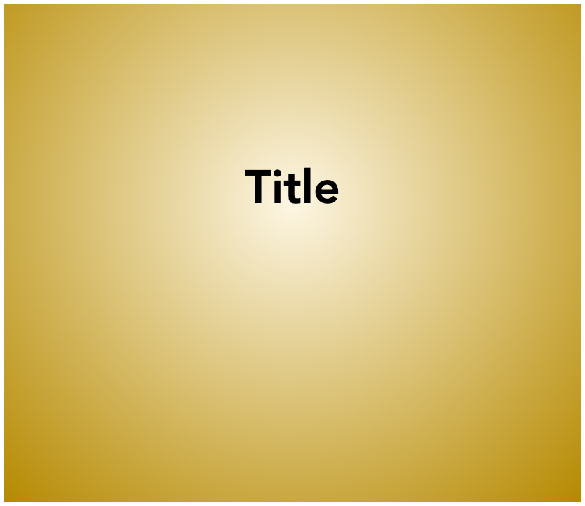
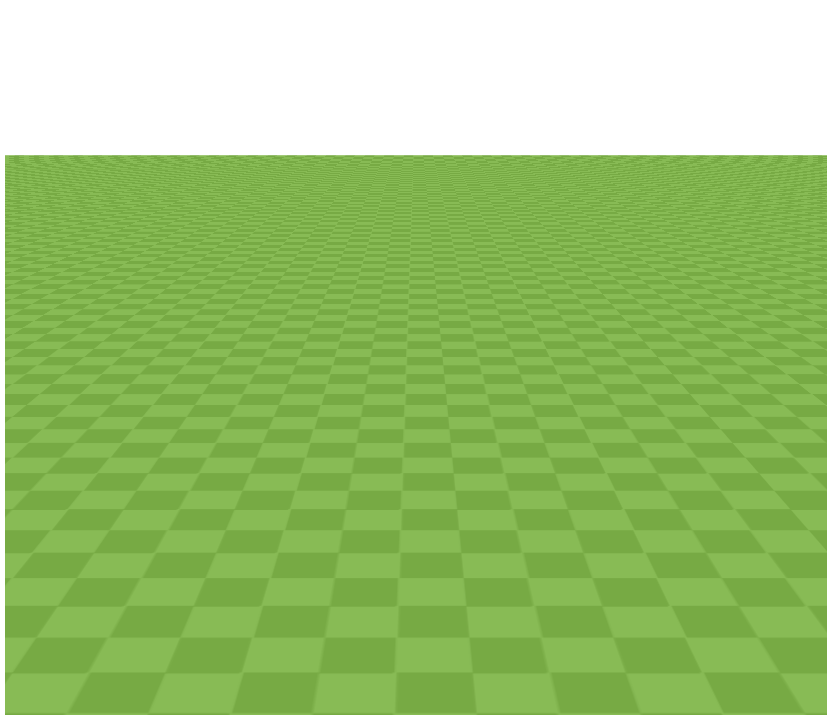
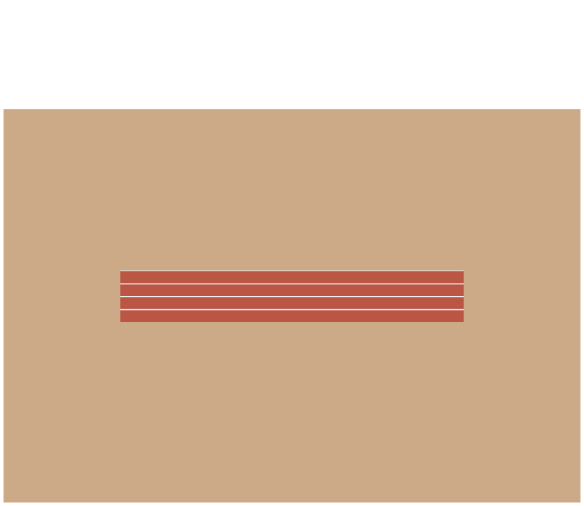
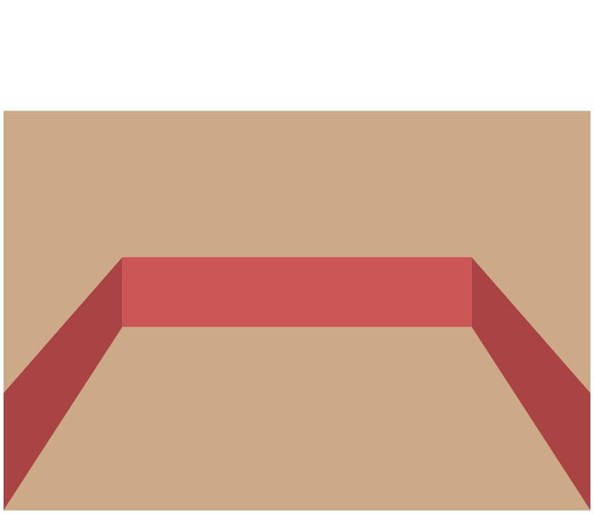
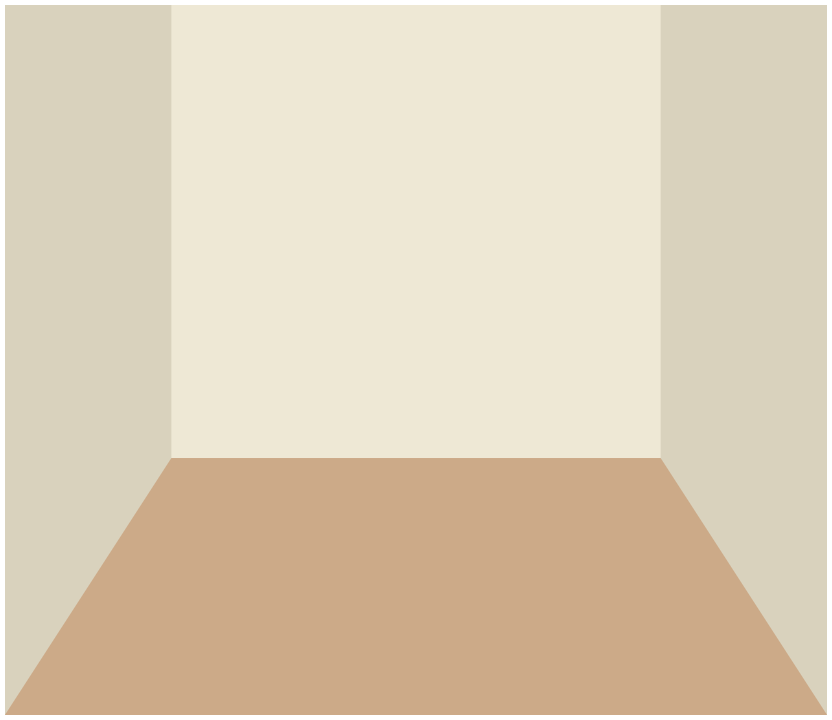
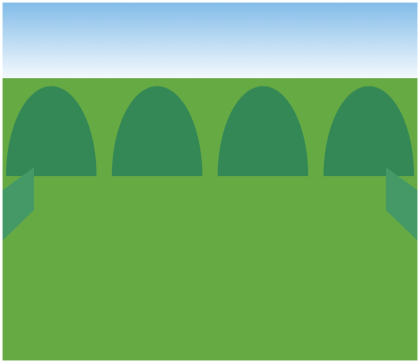
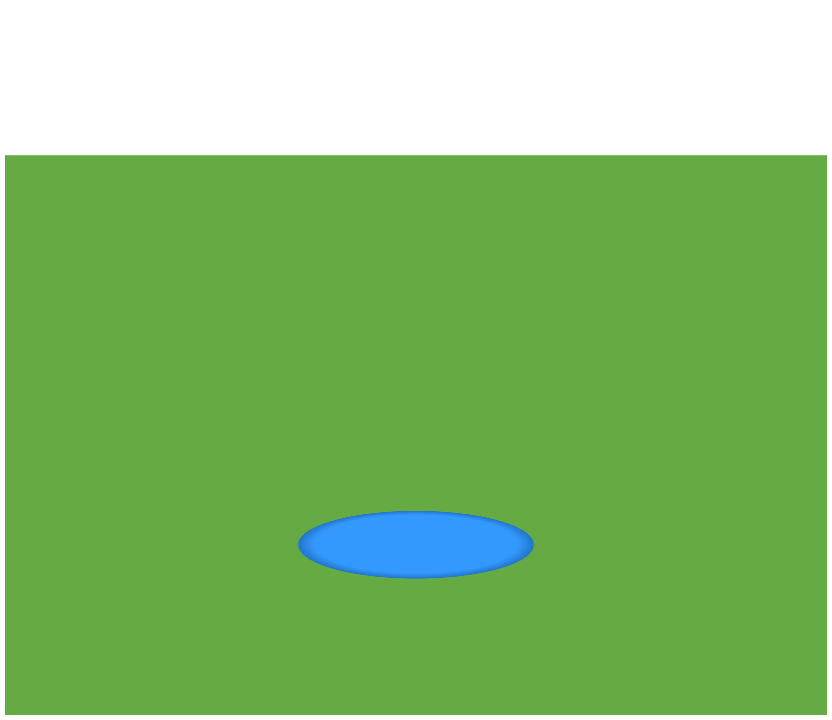
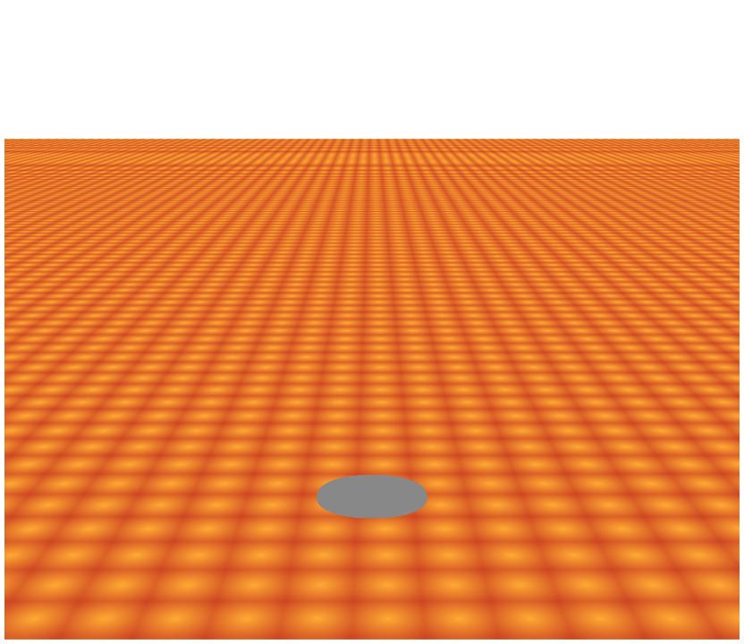
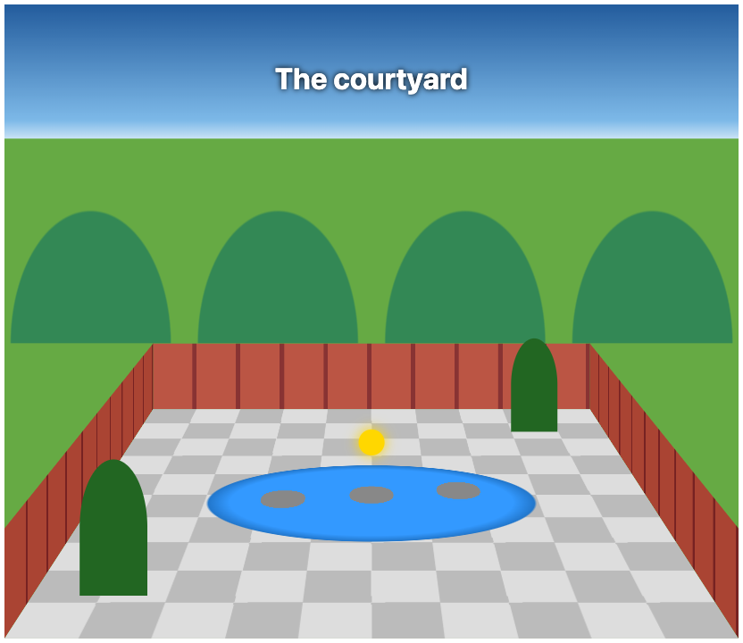

# Sample elements

Copy-and-paste HTML for each part of a 2.5D scene, with a picture of how it looks. Each sample is a whole template
that you can paste into the scene renderer (<http://localhost:5173/scene-renderer> when running locally), and most add
a plain floor so you can see where they stand. The pictures are taken in that renderer, with the default floor.

[Positions, sizes and units](../positions-sizes-units.md) explains the units, and
[floor surfaces](../game-data.md#floor-surfaces) and [floor-placed items](../game-data.md#floor-placed-items) say what
each class and attribute does.

The samples use colours and CSS gradients so they need no resources. In a game, use your own pictures as
[resources](../game-data.md#resources): `background: url('{{resources.sky}}')`.

## The screen background

For a scene with no floor or sky, such as a title. It fills the whole screen, square on, behind everything; the rest
of the template lays out in the scene box as usual.

```html [docs/tutorials/samples/screen-background.html]
<div class="screen-background" style="background: radial-gradient(circle at 50% 40%, #fdf6e3, #b58900)"></div>

<h1 style="margin-top: 30cqh; text-align: center; font-size: 8cqw">Title</h1>
```



## The horizon and the sky

`horizon-background` is the furthest backdrop. It stands upright at the horizon and fills the screen above it. The
floor background reaches back to meet it.

```html [docs/tutorials/samples/horizon-background.html]
<div class="horizon-background" style="background: linear-gradient(#1e5799, #7db9e8 80%, #fff)"></div>

<div class="floor-background" style="background: #6a4"></div>
```


## The floor background

The endless floor, from the bottom of the screen to the horizon. The engine sizes its box, so size a texture with
`--floor-unit` to keep it at the floor's scale: here each square is 10 floor units, a tenth of the floor's width.

```html [docs/tutorials/samples/floor-background.html]
<div
  class="floor-background"
  style="
    background: repeating-conic-gradient(#8b5 0 25%, #7a4 0 50%) 0 0 / calc(var(--floor-unit) * 20)
      calc(var(--floor-unit) * 20);
  "
></div>
```



## Walls

Walls stand on the floor's edges. How high one stands depends on how you size it.

### At its content's height

With no height set, the wall's box's shape sets its height. A box 15% as high as it is wide makes a wall 15 floor
units high, as the floor is 100 wide.

```html [docs/tutorials/samples/wall-content-height.html]
<div class="floor-background" style="background: #ca8"></div>

<div
  class="rear-wall"
  style="aspect-ratio: 100 / 15; background: repeating-linear-gradient(#eee 0 2%, #b54 0 25%), #b54"
></div>
```



### At a set height

`data-floor-height` sets the height in floor units, whatever the box. The engine sizes the box.

```html [docs/tutorials/samples/wall-set-height.html]
<div class="floor-background" style="background: #ca8"></div>

<div class="rear-wall" data-floor-height="20" style="background: #c55"></div>
<div class="left-wall" data-floor-height="20" style="background: #a44"></div>
<div class="right-wall" data-floor-height="20" style="background: #a44"></div>
```



### Filling the screen

`data-fill-height` stretches a wall up to the top of the screen, and `data-fill-width` stretches a rear or front wall
out to the screen's sides. Together they make a room.

```html [docs/tutorials/samples/wall-fill-screen.html]
<div class="floor-background" style="background: #ca8"></div>

<div class="rear-wall" data-fill-height data-fill-width style="background: #eee8d5"></div>
<div class="left-wall" data-fill-height style="background: #d9d2bd"></div>
<div class="right-wall" data-fill-height style="background: #d9d2bd"></div>
```



## Backgrounds

Backgrounds are upright, like walls, but stand further out (50 floor units by default; `data-wall-distance` sets it).
Use them for hills, buildings or trees around the floor.

```html [docs/tutorials/samples/backgrounds.html]
<div class="horizon-background" style="background: linear-gradient(#7db9e8, #fff)"></div>
<div class="floor-background" style="background: #6a4"></div>

<div
  class="rear-background"
  data-wall-distance="100"
  data-fill-width
  style="
    aspect-ratio: 100 / 20;
    background: radial-gradient(ellipse at 50% 100%, #385 60%, transparent 61%) 0 100% / 25% 100% repeat-x;
  "
></div>
<div class="left-background" data-wall-distance="30" style="aspect-ratio: 100 / 15; background: #496"></div>
<div class="right-background" data-wall-distance="30" style="aspect-ratio: 100 / 15; background: #496"></div>
```



## Floor areas

`data-floor-area="left back right front"` lays an element flat on that rectangle of the floor. Feet only count where
it's drawn, so a round pond is round to stand on.

```html [docs/tutorials/samples/floor-area.html]
<div class="floor-background" style="background: #6a4"></div>

<div
  id="pond"
  data-floor-area="30 30 70 60"
  style="background: radial-gradient(#39f 60%, #27c 69%, transparent 70%)"
></div>
```



## Floor items

`data-floor-y` (and `data-floor-x`) stands an item on a floor spot, scaled for its distance. Size it as it would look at
the front of the floor. `data-floor-height` lifts it above the floor, and `data-floor-anchor` says which point of it
sits on the spot: the lantern's centre hangs 20 floor units up.

```html [docs/tutorials/samples/floor-items.html]
<div class="floor-background" style="background: #6a4"></div>

<div
  id="near-tree"
  data-floor-x="25"
  data-floor-y="90"
  style="width: 10cqw; height: 25cqh; background: #262; border-radius: 50% 50% 0 0"
></div>
<div
  id="far-tree"
  data-floor-x="75"
  data-floor-y="10"
  style="width: 10cqw; height: 25cqh; background: #262; border-radius: 50% 50% 0 0"
></div>
<div
  id="lantern"
  data-floor-x="50"
  data-floor-y="50"
  data-floor-height="20"
  data-floor-anchor="center center"
  style="width: 4cqw; height: 4cqw; background: gold; border-radius: 50%; box-shadow: 0 0 2cqw gold"
></div>
```


## Clickable elements

Anything a template draws can be clicked; a rule says what happens. Give the element an `id` for the rule to target,
and `role="button"` and `tabindex="0"` so keyboard players can reach it too.

```html [docs/tutorials/samples/clickable.html]
<div class="screen-background" style="background: #234"></div>

<div
  id="bell"
  role="button"
  tabindex="0"
  aria-label="Ring the bell"
  style="
    width: 15cqw;
    aspect-ratio: 1;
    margin: 30cqh auto 0;
    background: gold;
    border-radius: 50% 50% 10% 10%;
    cursor: pointer;
  "
></div>
```


A rule in the scene's data reacts to the click. This one is from the Demo scenes game's lamps:

```json [public/game-repository.json]
{
  "on": { "interact": "click", "target": "#lamp-1" },
  "if": "not state.done",
  "do": [{ "set": { "lamp1": "not state.lamp1" } }, { "sound": "chime" }]
},
```

See [rules](../game-data.md#rules) and [interactions](../game-data.md#interactions).

## Standable elements

Something to stand on is usually a floor area, so that feet count only where it's drawn. Surfaces paint beneath the
rest of their template, so wrap the scene in a `noClicks` element, which lets the pointer through to them. In the
renderer, the mouse is the player's feet.

```html [docs/tutorials/samples/standable.html]
<div class="noClicks">
  <div
    class="floor-background"
    style="
      background: #c42 radial-gradient(#fa3, transparent) 0 0 / calc(var(--floor-unit) * 10)
        calc(var(--floor-unit) * 10);
    "
  ></div>
  <div id="stone" data-floor-area="40 40 60 60" style="background: #888; border-radius: 45%"></div>
</div>
```



A `foot-enter` rule reacts to standing on it. The demo's "The floor is lava" stage uses `jump-onto` to hop between
stones, and `foot-enter` on the lava:

```json [public/game-repository.json]
{
  "on": { "interact": ["foot-enter"], "target": "#lava" },
  "if": "not state.burning",
…
},
{
  "on": { "interact": ["jump-onto"], "target": "#stone-2" },
  "if": "state.on == 1",
```

The [2.5D scene tutorial](2-5d-scene.md) builds that stage.

## Putting it together

A whole scene, made from the samples above: sky and hills, a tiled courtyard with brick walls round the back and
sides, a pond with stepping stones, two trees and a hanging lantern, and a title. Paste it into the scene renderer
and tick **Show floor** to see how it sits on the floor. Each part is labelled with a comment.

```html [docs/tutorials/samples/courtyard.html]
<!-- Sky, ground, and hills beyond the walls -->
<div class="horizon-background" style="background: linear-gradient(#1e5799, #7db9e8 80%, #fff)"></div>
<div class="floor-background" style="background: #6a4"></div>
<div
  class="rear-background"
  data-wall-distance="60"
  data-fill-width
  style="
    aspect-ratio: 100 / 20;
    background: radial-gradient(ellipse at 50% 100%, #385 60%, transparent 61%) 0 100% / 25% 100% repeat-x;
  "
></div>

<!-- A tiled courtyard, ten tiles across -->
<div
  data-floor-area="0 0 100 100"
  style="aspect-ratio: 1; background: repeating-conic-gradient(#ddd 0 25%, #bbb 0 50%) 0 0 / 20% 20%"
></div>

<!-- Brick walls, 15 floor units high, round the back and sides -->
<div
  class="rear-wall"
  data-floor-height="15"
  style="
    background: repeating-linear-gradient(
      90deg,
      #b54 0 calc(var(--floor-unit) * 9),
      #833 0 calc(var(--floor-unit) * 10)
    );
  "
></div>
<div
  class="left-wall"
  data-floor-height="15"
  style="
    background: repeating-linear-gradient(
      90deg,
      #a43 0 calc(var(--floor-unit) * 9),
      #722 0 calc(var(--floor-unit) * 10)
    );
  "
></div>
<div
  class="right-wall"
  data-floor-height="15"
  style="
    background: repeating-linear-gradient(
      90deg,
      #a43 0 calc(var(--floor-unit) * 9),
      #722 0 calc(var(--floor-unit) * 10)
    );
  "
></div>

<!-- A pond, and stepping stones across it -->
<div
  id="pond"
  data-floor-area="20 35 80 70"
  style="background: radial-gradient(#39f 60%, #27c 69%, transparent 70%)"
></div>
<div id="stone-1" data-floor-area="30 48 38 56" style="background: #888; border-radius: 45%"></div>
<div id="stone-2" data-floor-area="46 46 54 54" style="background: #888; border-radius: 45%"></div>
<div id="stone-3" data-floor-area="62 44 70 52" style="background: #888; border-radius: 45%"></div>

<!-- Trees, the far one smaller, and a lantern hanging 20 units up -->
<div
  id="near-tree"
  data-floor-x="12"
  data-floor-y="88"
  style="width: 10cqw; height: 25cqh; background: #262; border-radius: 50% 50% 0 0"
></div>
<div
  id="far-tree"
  data-floor-x="85"
  data-floor-y="15"
  style="width: 10cqw; height: 25cqh; background: #262; border-radius: 50% 50% 0 0"
></div>
<div
  id="lantern"
  data-floor-x="50"
  data-floor-y="80"
  data-floor-height="20"
  data-floor-anchor="center center"
  style="width: 4cqw; height: 4cqw; background: gold; border-radius: 50%; box-shadow: 0 0 2cqw gold"
></div>

<!-- Plain HTML: a title in the scene box, in front of everything -->
<h1
  class="noClicks"
  style="
    position: absolute;
    top: 2cqh;
    width: 100%;
    margin: 0;
    text-align: center;
    color: white;
    font: bold 5cqh system-ui;
    text-shadow: 0 0 1cqh #000;
  "
>
  The courtyard
</h1>
```



Things to try in it:

- Give the walls `data-fill-height`, and the courtyard becomes a room open to the sky.
- Move the far tree's `data-floor-y` from 15 to 95, and it grows as it comes to the front.
- Add `data-fill-width` to the left wall to see a validation warning, or `data-depth="3"` to the lantern to see a
  problem.
